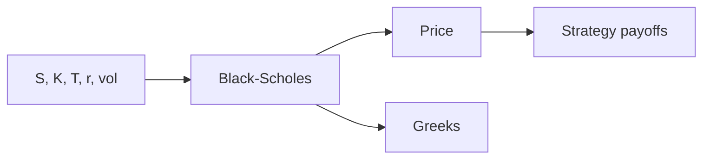

<p align="center">
  
</p>

<h1 align="center">Options Trading Bot</h1>

<p align="center">
  <strong>Options trading bot — Black-Scholes pricing, Greeks, and strategy payoffs in Python.</strong><br>
  Price European options, compute the Greeks, and analyse covered calls and straddles.
</p>

<p align="center">
  <em>Built and maintained by <a href="https://viprasol.com">Viprasol Tech</a> — Fintech Experts. Full-Stack Builders.</em>
</p>

<p align="center">
  <a href="https://github.com/Viprasol-Tech/options-trading-bot/actions/workflows/ci.yml"></a>
  <a href="LICENSE"></a>
  
  <a href="https://t.me/viprasol_help"></a>
  <a href="https://github.com/Viprasol-Tech/options-trading-bot/stargazers"></a>
</p>

---

> ## ⚠️ Disclaimer
> This software is for **educational purposes only** and is **not financial advice**. Options trading involves substantial risk, including the **total loss of capital** and, for some strategies, unlimited loss. Model prices are theoretical and ignore real-world frictions. Always test thoroughly and consult a licensed advisor. **Use at your own risk** — Viprasol Tech assumes no responsibility for your trading results.

---

## ✨ Features

- 🧮 **Black-Scholes pricing** — European calls and puts, standard-library only (no scipy).
- 📐 **Full Greeks** — delta, gamma, vega, theta, rho.
- 🪜 **Strategy payoffs** — covered call, long straddle, and single-leg payoffs.
- ✅ **Verifiable** — tests assert put-call parity, delta bounds, and reference values.
- 🖥️ **CLI** — `options-trading-bot price` and `options-trading-bot covered-call`.
- ⚙️ **Modern tooling** — ruff, mypy (strict), pytest, GitHub Actions CI.

## 🚀 Quickstart

```bash
git clone https://github.com/Viprasol-Tech/options-trading-bot.git
cd options-trading-bot
python -m pip install -e ".[dev]"

# Price an ATM 30-day call and show Greeks
options-trading-bot price --spot 100 --strike 100 --days 30 --vol 0.2

# Covered-call payoff
options-trading-bot covered-call --entry 100 --strike 110 --premium 3
```

## 🧩 Pricing in code

```python
from options_trading_bot.bsm import price, greeks, OptionType

p = price(spot=100, strike=105, t=0.25, r=0.05, vol=0.2, option=OptionType.CALL)
g = greeks(spot=100, strike=105, t=0.25, r=0.05, vol=0.2, option=OptionType.CALL)
print(p, g.delta, g.theta)
```

## 🏗️ Architecture



## 🗺️ Roadmap

- [x] Black-Scholes pricing + Greeks + payoffs
- [ ] Implied-volatility solver
- [ ] More strategies (spreads, iron condor, butterflies)
- [ ] Live options-chain data adapters

## 🤝 Contributing

PRs welcome — see [CONTRIBUTING.md](CONTRIBUTING.md) and our [Code of Conduct](CODE_OF_CONDUCT.md).

## 📬 Contact — Viprasol Tech Private Limited

- 🌐 Website: [viprasol.com](https://viprasol.com)
- ✉️ Email: [support@viprasol.com](mailto:support@viprasol.com)
- 💬 Telegram: [t.me/viprasol_help](https://t.me/viprasol_help) · 📱 WhatsApp: +91 96336 52112
- 🐙 GitHub: [@Viprasol-Tech](https://github.com/Viprasol-Tech) · 💼 [LinkedIn](https://www.linkedin.com/in/viprasol/) · 𝕏 [@viprasol](https://twitter.com/viprasol)

> *Viprasol Tech — fintech software, algorithmic trading systems, MT4/MT5 bots, AI voice agents, and B2B SaaS. Need a custom build? [Get in touch](mailto:support@viprasol.com).*

## 📄 License

[MIT](LICENSE) © 2025 Viprasol Tech Private Limited
