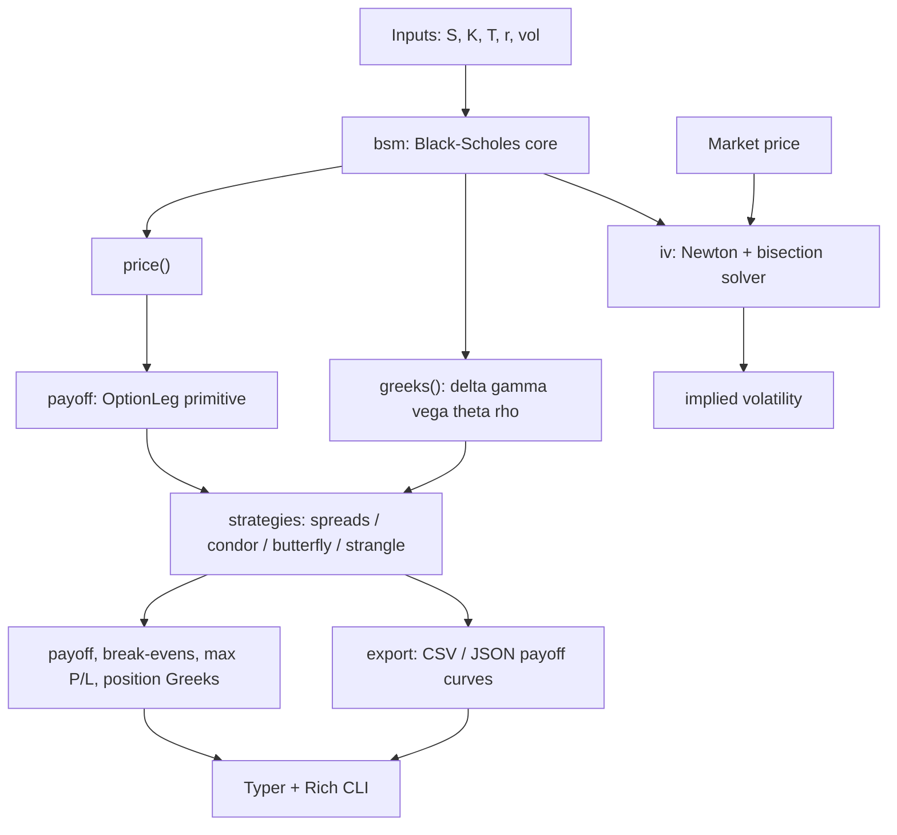

<p align="center">
  
</p>

<h1 align="center">Options Trading Bot</h1>

<p align="center">
  <strong>Black-Scholes pricing, full Greeks, an implied-volatility solver, and battle-tested multi-leg strategies — pure-Python, zero heavy deps.</strong><br>
  Price options, recover implied vol from market quotes, build spreads / condors / butterflies, and export plot-ready payoff curves.
</p>

<p align="center">
  <em>Built and maintained by <a href="https://viprasol.com">Viprasol Tech</a> — Fintech Experts. Full-Stack Builders.</em>
</p>

<p align="center">
  <a href="https://github.com/Viprasol-Tech/options-trading-bot/actions/workflows/ci.yml"></a>
  <a href="LICENSE"></a>
  
  
  
  
  
  <a href="https://t.me/viprasol_help"></a>
  <a href="https://github.com/Viprasol-Tech/options-trading-bot/stargazers"></a>
</p>

---

> ## ⚠️ Disclaimer
> This software is for **educational purposes only** and is **not financial advice**. Options trading involves substantial risk, including the **total loss of capital** and, for some strategies (e.g. short/naked legs), **theoretically unlimited loss**. Model prices are theoretical Black-Scholes values that ignore real-world frictions — slippage, early exercise, dividends, liquidity, and assignment risk. Always test thoroughly with your own data and consult a licensed advisor before trading. **Use at your own risk** — Viprasol Tech assumes no responsibility for your trading results.

---

## ✨ Features

- 🧮 **Black-Scholes pricing** — European calls and puts using only `math` from the standard library (no scipy/numpy required for the core).
- 📐 **Full Greeks** — delta, gamma, vega, theta, and rho in one call.
- 🔎 **Implied-volatility solver** — Newton-Raphson driven by closed-form vega, with a guaranteed **bisection fallback** for deep ITM/OTM options and bad initial guesses. Raises a clear `IVError` on arbitrage-violating inputs.
- 🪜 **Multi-leg strategy engine** — a composable `OptionLeg` primitive and a `Strategy` class with payoff, **net debit/credit**, break-evens, max profit/loss, and quantity-weighted **position Greeks**.
- 🎯 **Ready-made strategies** — bull call / bear put (debit) & bull put / bear call (credit) verticals, **iron condor**, **long call butterfly**, and **long strangle**.
- 📊 **Payoff exporter** — write any strategy's payoff curve to **CSV or JSON** for matplotlib, Excel, or a web chart — no plotting dependency baked in.
- 🖥️ **Rich CLI** — `price`, `iv`, `strategy`, `export`, and `covered-call` subcommands with formatted tables.
- ✅ **Verifiable** — 47 tests asserting put-call parity, IV round-trips, payoff shapes, and exporter output.
- ⚙️ **Modern tooling** — ruff, mypy (strict), pytest, GitHub Actions CI.

## 🚀 Quickstart

```bash
git clone https://github.com/Viprasol-Tech/options-trading-bot.git
cd options-trading-bot
python -m pip install -e ".[dev]"

# Price an ATM 30-day call and show its Greeks
options-trading-bot price --spot 100 --strike 100 --days 30 --vol 0.2

# Recover implied volatility from a market price
options-trading-bot iv 2.50 --spot 100 --strike 100 --days 30

# Analyse an iron condor: payoff, break-evens, risk, position Greeks
options-trading-bot strategy iron-condor

# Export a butterfly payoff curve to JSON for plotting
options-trading-bot export butterfly --out payoff.json
```

## 🧩 Usage in code

```python
from options_trading_bot import (
    OptionType, price, greeks, implied_volatility, iron_condor,
)
from options_trading_bot.export import export_payoff

# 1) Price + Greeks
p = price(spot=100, strike=105, t=0.25, r=0.05, vol=0.2, option=OptionType.CALL)
g = greeks(spot=100, strike=105, t=0.25, r=0.05, vol=0.2, option=OptionType.CALL)
print(f"price={p:.4f}  delta={g.delta:.4f}  vega={g.vega:.4f}")

# 2) Recover implied volatility from a market quote (round-trips to ~0.20)
iv = implied_volatility(p, spot=100, strike=105, t=0.25, r=0.05, option=OptionType.CALL)
print(f"implied vol = {iv:.4%}")

# 3) Build and analyse an iron condor
condor = iron_condor(90, 95, 105, 110, premiums=(1.0, 2.5, 2.5, 1.0))
print(condor.net_premium())            # +3.0 -> net credit
print(condor.break_evens(70, 130))     # [92.0, 108.0]
print(condor.max_profit(70, 130), condor.max_loss(70, 130))  # 3.0, -2.0
print(condor.position_greeks(spot=100, t=0.08, r=0.05, vol=0.2).delta)

# 4) Export the payoff curve for plotting
export_payoff(condor, "condor.csv", low=80, high=120, steps=41)
```

A full walkthrough lives in [`examples/quickstart.py`](examples/quickstart.py).

## 🏗️ Architecture



## 📚 API & CLI at a glance

| Area        | Function / Command                                   | What it does                                              |
|-------------|------------------------------------------------------|----------------------------------------------------------|
| Pricing     | `price(S, K, t, r, vol, option)`                     | Black-Scholes price of a European call/put               |
| Greeks      | `greeks(...) -> Greeks`                               | delta, gamma, vega, theta, rho                            |
| Implied vol | `implied_volatility(mkt, S, K, t, r, option)`        | Newton-Raphson + bisection IV solver                     |
| Strategy    | `bull_call_spread`, `iron_condor`, `long_call_butterfly`, … | Build named multi-leg `Strategy` objects           |
| Analytics   | `Strategy.break_evens / max_profit / position_greeks`| Risk/reward and aggregate Greeks                         |
| Export      | `export_payoff(strategy, path, low, high, steps)`    | Write payoff curve to CSV/JSON                            |
| CLI         | `price`, `iv`, `strategy`, `export`, `covered-call`  | Same capabilities from the terminal                      |

## 🗺️ Roadmap

- [x] Black-Scholes pricing + full Greeks
- [x] Implied-volatility solver (Newton + bisection)
- [x] Vertical spreads, iron condor, butterfly, strangle with payoff + Greeks
- [x] Payoff-curve exporter (CSV / JSON)
- [x] CLI subcommands (`price`, `iv`, `strategy`, `export`)
- [ ] American-option pricing (binomial / trinomial trees)
- [ ] Dividend yield (`q`) and forward pricing
- [ ] Live options-chain data adapters
- [ ] Volatility-surface fitting

## ❓ FAQ

**Does this place real trades?** No. It is a pricing, analytics, and strategy-modelling library — there is no broker connectivity. It is built for research and education.

**Why no scipy/numpy in the core?** The pricing, Greeks, and IV solver use only the standard library so the core is tiny and dependency-light. `pydantic`, `typer`, and `rich` power config and the CLI.

**How does the IV solver stay robust?** It starts with Newton-Raphson (using closed-form vega) and falls back to bisection whenever vega is too small or a step leaves the bounds — guaranteeing convergence because price is monotone in volatility.

**Are these European or American options?** European. American-style pricing is on the roadmap.

## 🤝 Contributing

PRs welcome — see [CONTRIBUTING.md](CONTRIBUTING.md) and our [Code of Conduct](CODE_OF_CONDUCT.md). Before opening a PR, run `ruff check . && ruff format . && mypy src && pytest`.

## Contact — Viprasol Tech Private Limited

- Website: [viprasol.com](https://viprasol.com)
- Email: [support@viprasol.com](mailto:support@viprasol.com)
- Telegram: [t.me/viprasol_help](https://t.me/viprasol_help) | WhatsApp: +91 96336 52112
- GitHub: [@Viprasol-Tech](https://github.com/Viprasol-Tech) | [LinkedIn](https://www.linkedin.com/in/viprasol/) | X [@viprasol](https://twitter.com/viprasol)

## License

[MIT](LICENSE) (c) 2025 Viprasol Tech Private Limited
